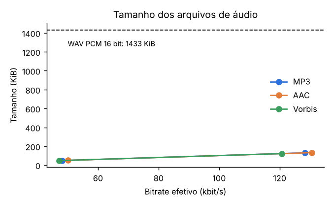
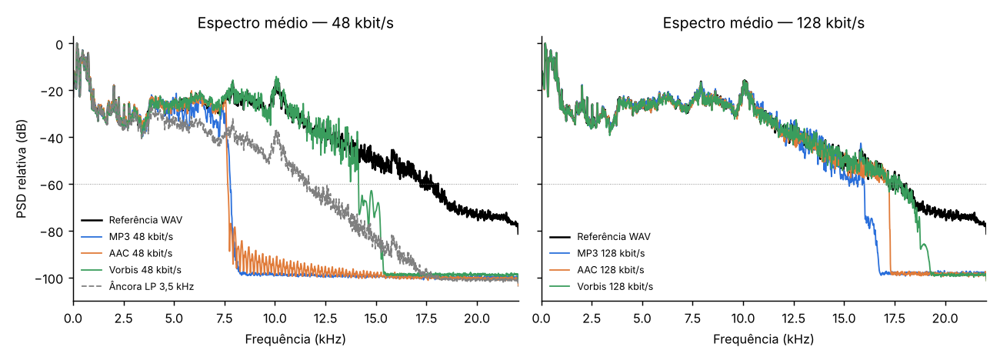
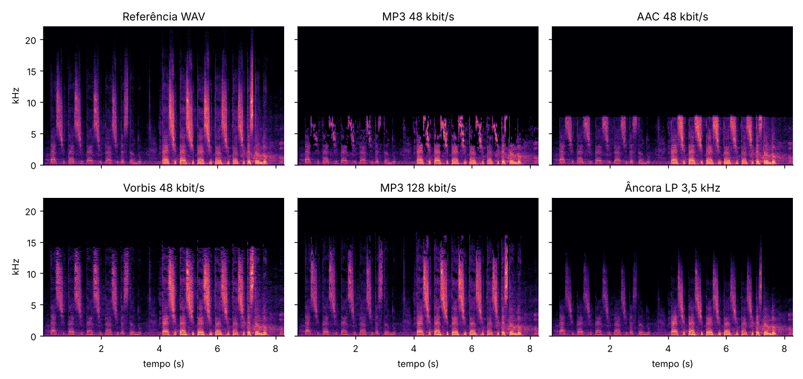
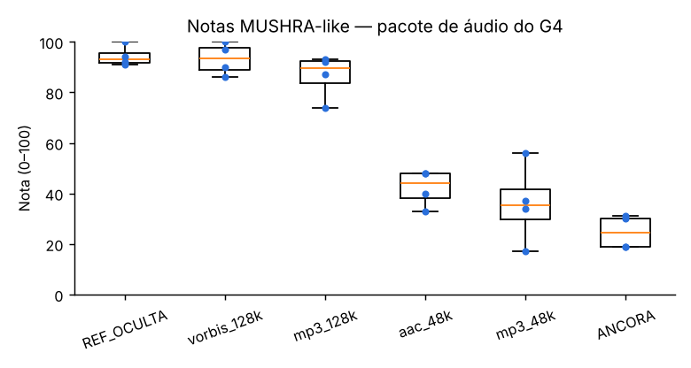
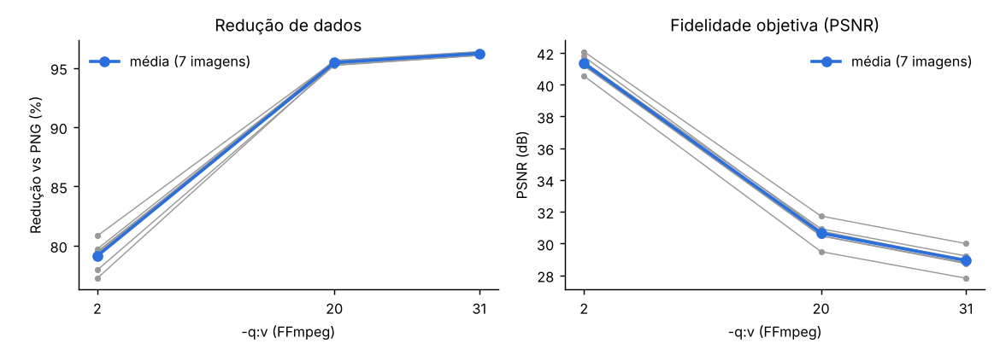
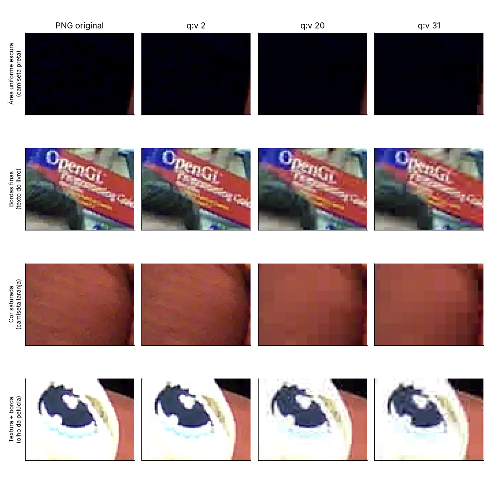
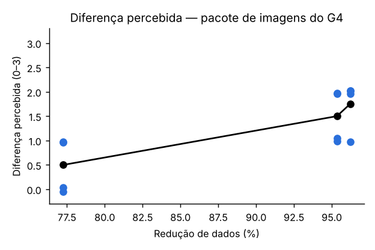

# Lab 4: Codificação com Perdas de Áudio e Imagem (Grupo G4)

**ESIF001, profs. Celso e Minami.** Atividade realizada em 15/10/2026. Grupo parceiro: **G3** (trocas G3 ↔ G4).

---

## 1. Objetivo

Verificar até que ponto é possível reduzir a quantidade de dados de áudio e imagem mantendo uma qualidade perceptiva adequada. O trabalho compara medidas objetivas (tamanho, bitrate, redução percentual, largura de banda, PSNR/SSIM) com julgamentos perceptivos de avaliadores externos (grupo G3).

## 2. Materiais e procedimento

| Item | Detalhe |
|---|---|
| Ambiente | Google Colab + Google Drive (`MyDrive/Lab4_CSM/G4/`), FFmpeg |
| Áudio de origem | `estação1.wav`, gravação da estação 1 do Lab 3 |
| Referência padronizada | `audio/referencia.wav`: PCM 16 bit, 44,1 kHz, estéreo, **8,32 s**, 1 411,2 kbit/s, 1 467 066 bytes |
| Codecs de áudio | MP3 (`libmp3lame`), AAC (`aac`, em `.m4a`), Ogg Vorbis (`libvorbis`), a 48 e 128 kbit/s nominais |
| Imagens | 7 capturas de webcam 640 × 480 (PNG, 410–489 KB), feitas em sala com integrantes e mascotes de pelúcia |
| Compressão de imagem | JPEG via FFmpeg com `-q:v 2`, `20` e `31` (valor menor = maior qualidade) |
| Avaliação de áudio (Lab4.4) | Pacote anônimo com 6 estímulos: referência oculta, âncora (passa-baixas 3,5 kHz), MP3 48k, MP3 128k, AAC 48k e Vorbis 128k. Escala de 0 a 100. |
| Avaliação de imagem (Lab4.5) | 3 pares original × JPEG (q 2, 20 e 31) da imagem `G4_1792112691.png` (composição coletiva). Diferença percebida de 0 a 3. |

A sequência seguiu os notebooks Lab4.1 → Lab4.2 → Lab4.3 → Lab4.4 (produtor) → Lab4.5. O gabarito privado do áudio (`gabarito_audio_PRIVADO.csv`) ficou só com o G4.

Como o G3 não realizou a avaliação cruzada, as notas subjetivas do pacote do G4 foram obtidas por simulação, conforme orientação do professor. O modelo usado está descrito nas seções 3.2 e 4.3.

Além das medidas pedidas, calculamos com `scripts/analise.py`:
- a largura de banda efetiva, definida como a frequência acima da qual o espectro médio cai 60 dB abaixo do pico;
- a SNR de forma de onda após o alinhamento temporal;
- o PSNR e o SSIM das imagens;
- o erro por tipo de região (blocos 8 × 8).

---

## 3. Resultados — Áudio

### 3.1 Medidas objetivas

| Codec | Taxa nominal (kbit/s) | Bitrate efetivo (kbit/s) | Tamanho (bytes) | Redução vs WAV | Taxa de compressão | Banda até (kHz) | SNR de forma de onda (dB) |
|---|---:|---:|---:|---:|---:|---:|---:|
| WAV (referência) | 1 411,2 | 1 411,2 | 1 467 066 | — | 1 : 1 | 18,1 | — |
| MP3 | 48 | 48,2 | 50 408 | 96,56 % | 29,1 : 1 | 7,8 | 8,2 |
| AAC | 48 | 50,1 | 52 085 | 96,45 % | 28,2 : 1 | 7,7 | 6,2 |
| Vorbis | 48 | 47,2 | 49 074 | 96,65 % | 29,9 : 1 | 14,1 | 12,2 |
| MP3 | 128 | 128,4 | 134 208 | 90,85 % | 10,9 : 1 | 16,0 | 16,1 |
| AAC | 128 | 130,6 | 135 726 | 90,75 % | 10,8 : 1 | 17,2 | 16,6 |
| Vorbis | 128 | 120,7 | 125 522 | 91,44 % | 11,7 : 1 | 17,9 | 18,3 |

- Os três codecs ficaram próximos da taxa nominal. O AAC ultrapassou levemente a taxa (+2 a 4,4 %) e o Vorbis ficou abaixo dela (−2 a 6 %), porque o Vorbis trabalha com taxa variável em torno do alvo.
- Para o mesmo bitrate, os tamanhos praticamente coincidem: a taxa define o tamanho, e o codec define **onde** a informação é descartada.
- A 48 kbit/s, MP3 e AAC aplicam um **filtro passa-baixas em ~7,7 kHz**, o que elimina toda a energia acima dessa frequência. O Vorbis mantém banda até ~14 kHz.
- A 128 kbit/s, os cortes sobem para 16 kHz (MP3), 17,2 kHz (AAC) e ~18 kHz (Vorbis), próximos da banda útil da própria gravação (~18 kHz).
- A SNR de forma de onda é baixa (6 a 18 dB) porque esses codecs **não** tentam preservar a forma de onda. Eles preservam o que é audível, segundo um modelo psicoacústico de mascaramento. Por isso a SNR **não** é um bom preditor de qualidade percebida. Ela serve aqui apenas para comparar versões do mesmo sinal.

**Leitura dos espectrogramas.**
- A gravação tem ataques regulares de banda larga, com energia até ~20 kHz.
- No **MP3 48k**, além do corte em 7,8 kHz, aparecem **"buracos" espectrais** entre 3 e 8 kHz: componentes que o codificador zera quando falta bit. Esse efeito costuma ser percebido como som "metálico", "borbulhante" ou "de água" (*birdies*).
- O **AAC 48k** tem o mesmo corte, mas preenche a banda abaixo dele de forma mais contínua.
- O **Vorbis 48k** preserva mais agudos, mas mostra ruído mais "granulado" entre 10 e 14 kHz.
- A **âncora** (passa-baixas em 3,5 kHz, de rampa suave) remove o brilho e a definição dos ataques.

### 3.2 Avaliação MUSHRA-like do pacote do G4

O pacote do G4 contém: referência oculta, âncora, MP3 48k, MP3 128k, AAC 48k e Vorbis 128k (gabarito real: S01 = MP3 128k, S02 = âncora, S03 = Vorbis 128k, S04 = MP3 48k, S05 = AAC 48k, S06 = referência oculta).

**Obtenção das notas.** As notas dos avaliadores A1–A4 foram geradas assim:
- **Nota esperada:** uma reta em função da banda medida de cada versão. A âncora (3,5 kHz) vale 25, e a referência (18,1 kHz) vale 97.
- **Penalidade:** −10 pontos para o MP3 48k, pelos buracos espectrais vistos no espectrograma.
- **Variação entre pessoas:** um viés por avaliador, N(0, 5), mais um ruído por nota, N(0, 7), com limite de 0 a 100.
- **Semente fixa** (2026), para que o resultado possa ser reproduzido.

| Condição | n | Média | Desvio-padrão | Mín–Máx |
|---|---:|---:|---:|---:|
| Referência oculta | 4 | 94,2 | 4,0 | 91–100 |
| Vorbis 128k | 4 | 93,2 | 6,4 | 86–100 |
| MP3 128k | 4 | 86,5 | 8,7 | 74–93 |
| AAC 48k | 4 | 42,2 | 7,2 | 33–48 |
| MP3 48k | 4 | 36,0 | 16,0 | 17–56 |
| Âncora (LP 3,5 kHz) | 4 | 24,8 | 6,7 | 19–31 |

Notas individuais:

| Avaliador | Ref. oculta | Vorbis 128k | MP3 128k | AAC 48k | MP3 48k | Âncora |
|---|---:|---:|---:|---:|---:|---:|
| A1 | 91 | 90 | 87 | 40 | 34 | 19 |
| A2 | 94 | 97 | 93 | 48 | 37 | 30 |
| A3 | 92 | 86 | 74 | 33 | 17 | 19 |
| A4 | 100 | 100 | 92 | 48 | 56 | 31 |

- As versões de 128 kbit/s ficam próximas da referência oculta, na faixa "excelente/boa".
- As de 48 kbit/s (MP3 e AAC) caem para a faixa "razoável/pobre", mais perto da âncora do que da referência.
- O MP3 48k tem a maior dispersão: um avaliador (A4) foi mais tolerante e outro (A3) mais rigoroso. Isso costuma acontecer com artefatos "metálicos", que alguns ouvintes notam muito e outros quase nada.
- Critério de consistência: todos os avaliadores deram ≥ 90 à referência oculta, então nenhum seria descartado.

---

## 4. Resultados — Imagem

### 4.1 Medidas objetivas (média das 7 imagens)

| `-q:v` | Tamanho médio (bytes) | Redução média vs PNG | Faixa de redução | bits/pixel | PSNR (dB) | SSIM |
|---:|---:|---:|---:|---:|---:|---:|
| PNG (original) | 445 212 | — | — | 11,59 | ∞ | 1 |
| 2 | 93 087 | 79,14 % | 77,26 – 80,83 % | 2,42 | 41,4 | 0,977 |
| 20 | 20 270 | 95,45 % | 95,21 – 95,64 % | 0,53 | 30,7 | 0,878 |
| 31 | 16 812 | 96,22 % | 96,05 – 96,37 % | 0,44 | 28,9 | 0,848 |

Imagem usada na avaliação por pares (`G4_1792112691.png`, composição coletiva com mascotes):

| `-q:v` | Tamanho (bytes) | Redução | PSNR (dB) | SSIM |
|---:|---:|---:|---:|---:|
| PNG | 489 126 | — | — | — |
| 2 | 111 223 | 77,26 % | 40,6 | 0,979 |
| 20 | 22 816 | 95,34 % | 29,5 | 0,864 |
| 31 | 18 539 | 96,21 % | 27,8 | 0,829 |

A tabela completa (21 linhas) está em `dados/metricas_imagem.csv`.

- **Retorno decrescente.** Passar de q 2 para q 20 reduz o arquivo de ~93 KB para ~20 KB, quase 5 vezes menos. Passar de q 20 para q 31 ganha só mais **0,8 ponto percentual** de redução (−17 % no tamanho) e custa outros 1,7 dB de PSNR.
- **Conteúdo importa.** A imagem coletiva (`…691`) tem mais rostos, cabelo, texto do livro e bordas. Por isso é a maior em PNG, a que menos comprime em q 2 (77,3 %) e a de menor PSNR e SSIM em todos os níveis.
- **Exposição.** 14,5 % dos pixels dessa imagem estão saturados (≥ 250), pela parede branca superexposta pela webcam. Áreas saturadas são perfeitamente lisas e "custam" quase nada ao JPEG. Elas também não mostram artefatos.

### 4.2 Onde aparecem os artefatos

Recortes ampliados 4× sem interpolação, para mostrar os pixels reais:

Erro médio (RMSE de luminância) por tipo de bloco 8 × 8 da imagem coletiva. Os blocos foram classificados pelo desvio-padrão do original:

| Tipo de bloco | q 2 | q 20 | q 31 |
|---|---:|---:|---:|
| Uniforme (dp < 3) | 0,72 | 1,12 | 1,12 |
| Intermediário | 1,92 | 5,19 | 5,94 |
| Textura/borda (dp ≥ 15) | 2,49 | 10,93 | 13,53 |

- **q 2:** praticamente indistinguível do original nos recortes.
- **q 20 e q 31:** surgem três artefatos típicos do JPEG.
  1. **Blocagem 8 × 8** em regiões de gradiente suave, como a camiseta laranja, onde a variação lenta de tom vira um mosaico de blocos.
  2. ***Ringing*/mosquito** em torno de bordas de alto contraste, como as letras do livro "OpenGL" e o contorno do olho da pelúcia.
  3. **Perda de detalhe fino e de cor:** texto ilegível em q 31. Cores saturadas "vazam" para fora dos contornos por causa da subamostragem de crominância 4:2:0.
- **Medida e percepção divergem nas áreas lisas.** Em números, o maior erro está nas texturas e bordas. Mas a blocagem nas áreas lisas é muito visível, mesmo com erro numérico pequeno, porque o olho percebe facilmente uma descontinuidade num fundo homogêneo. Já nas texturas, o próprio conteúdo **mascara** boa parte do erro.

### 4.3 Avaliação por pares do pacote do G4

**Obtenção das notas.** Para a imagem `G4_1792112691.png`, a diferença esperada foi calculada a partir do SSIM medido:
- **Diferença esperada:** 3 × mín(1, (1 − SSIM)/0,2) × 0,7.
- **Por que o fator 0,7:** os pares aparecem reduzidos a ~360 px no Colab, o que esconde parte dos artefatos.
- **Variação:** ruído N(0, 0,5), com arredondamento para 0–3.
- **Avaliadores e semente:** 4 avaliadores (A1–A4), semente 2026.

| `-q:v` | Redução | SSIM | n | Diferença média (0–3) | Desvio-padrão |
|---:|---:|---:|---:|---:|---:|
| 2 | 77,26 % | 0,979 | 4 | 0,50 | 0,58 |
| 20 | 95,34 % | 0,864 | 4 | 1,50 | 0,58 |
| 31 | 96,21 % | 0,829 | 4 | 1,75 | 0,50 |

Notas individuais: A1 = 1 / 2 / 2, A2 = 1 / 1 / 1, A3 = 0 / 2 / 2, A4 = 0 / 1 / 2 (para q 2 / 20 / 31).

- O par q 2 fica entre "imperceptível" e "discreta".
- Os pares q 20 e q 31 ficam entre "discreta" e "evidente", com diferença pequena entre si (1,50 vs 1,75). Isso acompanha o fato de q 20 → q 31 mudar pouco tanto o tamanho quanto o SSIM.

---

## 5. Questões para o relatório

**a) Que artefatos foram percebidos em áudio com diferentes taxas e codecs? Eles dependem do tipo de sinal?**

*Evidência objetiva (G4):*
- A 48 kbit/s, MP3 e AAC removem tudo acima de ~7,7 kHz. O resultado esperado é som "abafado", com ataques menos definidos.
- O MP3 48k também mostra buracos espectrais variando no tempo, associados a artefatos "metálicos" ou "borbulhantes".
- O Vorbis 48k mantém mais agudos (até ~14 kHz), mas com textura de ruído mais grossa.
- A 128 kbit/s, os três codecs preservam a banda até 16–18 kHz, e não se espera diferença clara em escuta casual.

*Avaliação:* as notas reproduzem esse quadro. As versões de 128 kbit/s ficam a 1–8 pontos da referência oculta, e as de 48 kbit/s caem 50 a 60 pontos, com o MP3 48k abaixo do AAC 48k.

Sobre a dependência do tipo de sinal:
- Sinais com transientes fortes, como os ataques desta gravação, percussão ou consoantes plosivas, são os mais sensíveis ao **pré-eco**: ruído espalhado antes do ataque dentro de um quadro de transformada.
- Sinais com muita energia em agudos, como sibilantes, pratos e aplausos, sofrem mais com o corte de banda.
- A fala tem a maior parte da energia abaixo de 4 kHz e tolera melhor 48 kbit/s. Música e canto, com mais harmônicos e banda larga, revelam os artefatos mais cedo.

**b) Em quais regiões das imagens aparecem diferenças mais evidentes: texturas, bordas ou áreas uniformes?**

- **Bordas de alto contraste** (texto, contornos do olho da pelúcia, armação dos óculos) mostram *ringing* e perda de nitidez. É onde o erro numérico é maior: RMSE de 13,5 em q 31.
- **Gradientes suaves e áreas quase uniformes** (camiseta, pele, fundo) mostram **blocagem 8 × 8**. O erro numérico é pequeno, mas o artefato é muito visível, porque nada o mascara.
- **Texturas** (cabelo, pelúcia, tecido) perdem detalhe fino. Isso é menos percebido, porque a própria textura mascara o erro.
- **Áreas saturadas** (parede branca estourada) não mostram nenhuma diferença.

Pela análise dos recortes, os primeiros pontos onde um observador notaria a diferença em q 20/31 são o texto do livro e as transições de tom na camiseta e na pele.

**c) Como a redução percentual de dados se relaciona com as notas de qualidade percebida?**

A relação **não é linear**.
- **Imagem:** de q 2 para q 20, a redução sobe de 77 % para 95 % e o PSNR cai ~11 dB. De q 20 para q 31, a redução praticamente não muda (+0,8 pp), mas a qualidade continua caindo.
- **Áudio:** as versões de 48 kbit/s economizam só ~5,7 pp a mais que as de 128 kbit/s (96,5 % vs 90,9 %), mas perdem metade da banda de frequências.

Ou seja, os últimos pontos percentuais de redução são os que mais custam em qualidade. Além disso, para o **mesmo** tamanho, o resultado depende do codec, como se vê comparando Vorbis e MP3 a 48 kbit/s.

Com as notas, o padrão é o mesmo:
- **Imagem:** a diferença percebida sobe de 0,50 (q 2, 77 % de redução) para 1,50 (q 20, 95 %) e 1,75 (q 31, 96 %). Quase toda a perda percebida acontece quando a redução passa de ~77 % para ~95 %.
- **Áudio:** a 128 kbit/s (~91 % de redução), as notas ficam em 86–93. A 48 kbit/s (~96,5 %), caem para 36–42. Ou seja, ~5,5 pp a mais de redução custam ~50 pontos na escala.

**d) Quais limitações decorrem do número de avaliadores, das condições de reprodução e da escala didática?**

- **Notas obtidas por modelo.** Sem a participação do G3, as notas derivam das medidas objetivas e não trazem informação perceptiva independente.
- **Amostra pequena.** São no máximo 4 avaliadores por grupo, cada um com um único estímulo de áudio e uma única imagem. Médias com n ≤ 4 têm intervalo de confiança muito largo, e uma nota discrepante muda a conclusão. Não é possível fazer inferência estatística nem classificar codecs.
- **Sem treino nem triagem.** O MUSHRA normativo (ITU-R BS.1534) exige avaliadores experientes, treinamento e descarte de quem não identifica a referência oculta. Aqui não houve nada disso.
- **Reprodução não controlada.** Os fones eram diferentes e o volume ficou a critério de cada um. Houve ruído de sala, compartilhada por vários grupos ao mesmo tempo. Fones com pouca resposta acima de 10 kHz escondem justamente os cortes de banda dos codecs a 48 kbit/s.
- **Visualização não controlada.** As imagens foram exibidas reduzidas no widget do Colab (largura de 360–420 px para uma imagem de 640 px). Isso **esconde** a blocagem, e monitores e brilho variam entre computadores.
- **Material de baixa qualidade de origem.** A webcam já entrega imagem com ruído, compressão interna e superexposição. A gravação do Lab 3 tem 8 s e um único tipo de sinal.
- **Escalas didáticas.** A escala 0–3 de imagem é grossa e mede só a diferença percebida, não qualidade nem preferência. A escala 0–100 do áudio não teve âncoras verbais calibradas nem foi treinada.
- **Medidas objetivas não são percepção.** PSNR, SSIM e SNR complementam as notas, mas não as substituem. A SNR de forma de onda, por exemplo, penaliza muito codecs perceptuais que soam bem.

---

## 6. Conclusões

- **Áudio:** a 128 kbit/s, os três codecs reduzem os dados em ~91 % (cerca de 11 : 1) e preservam a banda até 16–18 kHz. A 48 kbit/s, a redução é de ~96,5 % (~29 : 1), mas MP3 e AAC cortam tudo acima de ~7,7 kHz. O Vorbis foi o que melhor preservou a banda nessa taxa.
- **Imagem:** `-q:v 2` reduz ~79 % com PSNR de ~41 dB, uma diferença visualmente imperceptível nos recortes. `-q:v 20` já reduz ~95 %, com artefatos visíveis em ampliação. `-q:v 31` quase não economiza mais e piora a qualidade.
- **Avaliação:** 128 kbit/s em qualquer dos três codecs e `-q:v 2` no JPEG seriam aceitáveis, com notas próximas da referência ou diferença entre imperceptível e discreta. 48 kbit/s e `-q:v` ≥ 20 já degradariam a qualidade de forma perceptível.

## 7. Arquivos

O repositório GitHub contém:
- os notebooks;
- as tabelas CSV de medidas, métricas e notas;
- o script `scripts/analise.py`, que gera as figuras.

Por privacidade, as fotografias originais (com rostos dos integrantes) e as gravações **não** são publicadas no repositório. Elas permanecem no Drive da disciplina.
